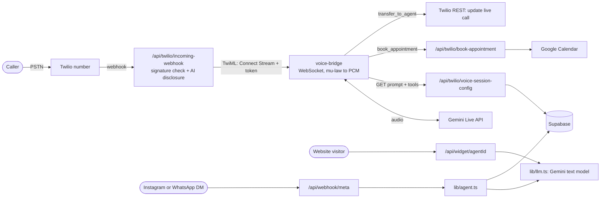

# Iupiter: an AI receptionist for real-estate agents, built and tested, never sold

**Author:** Nurbolat (Bo) Mirash, [polikuj101](https://github.com/polikuj101)  
**Looking for:** Forward Deployed Engineer roles  
**Contact:** bo.mirash@gmail.com, mirashnurbolat06@gmail.com

Iupiter answers an agent's inbound leads (phone calls, a website chat widget, Instagram/WhatsApp DMs) with an LLM, books appointments into Google Calendar, and can hand a live call to a human. I built it as a solo side project and tested it by hand. It never had a paying customer. This repository is the system plus an honest account of what I did and did not find out.

## Status, stated plainly

- **What exists:** a working prototype with 38 commits by one author ([polikuj101](https://github.com/polikuj101)), first commit 2026-04-04, last 2026-07-14. About 10,500 lines of TypeScript and TSX in the app (excluding tests) plus about 500 in the voice bridge, counted with `wc -l`.
- **Where it runs:** nowhere right now. The hosted deployment is paused. It can be brought back by restoring the Supabase project (author's statement; not tested for this README).
- **Commercial result:** none. There were no sales and no paying customers, so there is no revenue, retention, or conversion data. My notes show an outreach campaign was started in June 2026 and paused a day later; no results were recorded.
- **Inbound calls:** I never measured how many calls the phone line received.
- **Dates:** development ran April to July 2026. Commits after 2026-07-14 (importing the voice bridge, this README) were made in November 2026.
- **Who wrote the code:** AI coding assistants wrote the implementation. I did the architecture, the product and business decisions, and the sales. Commit trailers that credited the assistants were removed from the git history at my request; this paragraph is the disclosure.
- **Not claimed:** that it works for real customers. It has never been used by one.

## Why this exists

A real-estate agent is often in a showing, driving, or asleep when a buyer calls. The business question is whether a faster first response wins more leads.

- The best-known study of lead response speed is Oldroyd, McElheran and Elkington, ["The Short Life of Online Sales Leads"](https://hbr.org/2011/03/the-short-life-of-online-sales-leads), Harvard Business Review, March 2011 ([citation record](https://scholarsarchive.byu.edu/facpub/9711)). Its abstract says most companies "are not responding nearly fast enough". I could only read the abstract; the oft-quoted figures (for example "21 times more likely to qualify a lead within 5 minutes") come from secondary sources and I did not verify them in the paper. It studied online sales leads in general, not real estate.
- A figure often repeated in sales content is "78% of customers buy from the first company to respond". I could not trace it to a primary study, so I do not use it. An earlier version of my own notes relied on it; I removed it.
- Money at stake per deal: Redfin's closed-sale data put the average buyer's-agent commission at [2.42% in Q3 2025, up from 2.36% a year earlier](https://www.redfin.com/news/commissions-q3-2025). That is a rate, not a dollar figure: the dollar value depends on the sale price. An earlier "8 to 15 thousand per deal" figure in my notes had no source and is dropped.
- **The gap I aimed at:** voicemail and generic answering services take a message. A voice agent can answer, qualify, and book. The most common architecture for phone agents chains speech-to-text, an LLM, and text-to-speech. I chose a single speech-to-speech model instead (see design decisions), and that choice is where I hit latency limits in my own testing.

## Hypothesis

**Bet:** an AI that answers every inbound lead in seconds, around the clock, recovers leads agents would otherwise lose, and agents would pay about $150/month for it (my planned list price was $149).

| # | Claim | Verdict | Evidence |
|---|---|---|---|
| 1 | Slow response loses leads | Supported by outside research, not tested by me | HBR 2011 (abstract only), linked above |
| 2 | The AI answers faster than a human | **Partially confirmed** | I measured it by hand: faster than a human for the first 5 to 7 minutes of a live call, then up to about 5 seconds as the context grew. No log of this measurement exists in the repo |
| 3 | Agents will pay for it | **Not tested** | No sales were made |
| 4 | Agents would keep paying | **Not tested** | No customers |
| 5 | AI-handled leads turn into more appointments or deals | **Not tested** | No data on calls handled, appointments booked, or deals closed |
| 6 | Callers accept talking to an AI | **Not tested** | No caller feedback collected |
| 7 | Long calls stay responsive on a single speech-to-speech model | **Contradicted in my own testing** | The latency growth described in row 2 |

## What I built



| Component | What it does | Files |
|---|---|---|
| Text agent | Builds the prompt, calls Gemini, retries on a fallback model, optional `book_appointment` tool | [`lib/llm.ts`](lib/llm.ts), [`lib/agent.ts`](lib/agent.ts) |
| Website widget | Embeddable chat for an agent | [`app/api/widget/[agentId]/route.ts`](app/api/widget/[agentId]/route.ts), [`app/widget`](app/widget) |
| Instagram/WhatsApp | DM webhook with signature verification | [`app/api/webhook/meta/route.ts`](app/api/webhook/meta/route.ts), [`lib/meta-client.ts`](lib/meta-client.ts) |
| Inbound voice (app side) | Twilio webhook, session config, booking, shared-secret auth | [`app/api/twilio`](app/api/twilio), [`lib/bridge-auth.ts`](lib/bridge-auth.ts) |
| Voice bridge | Always-on WebSocket service joining Twilio audio to Gemini Live | [`voice-bridge/src`](voice-bridge/src) |
| Browser voice demo | Talk to the agent in a browser with no phone cost | [`app/voice-demo/page.tsx`](app/voice-demo/page.tsx), [`app/api/voice-demo/token/route.ts`](app/api/voice-demo/token/route.ts) |
| Outbound dialer (human) | Zadarma callback: rings me first, then bridges the lead | [`app/dashboard/dialer`](app/dashboard/dialer), [`lib/zadarma.ts`](lib/zadarma.ts) |
| Dashboard, CRM, calendar | Agents, conversations, contacts, Follow Up Boss, Google Calendar | [`app/dashboard`](app/dashboard), [`lib/follow-up-boss.ts`](lib/follow-up-boss.ts), [`lib/google-calendar.ts`](lib/google-calendar.ts) |
| Schema | Supabase migrations 001 to 010 | [`supabase/migrations`](supabase/migrations) |

### Design decisions and why

1. **One speech-to-speech model (Gemini Live) instead of speech-to-text, LLM, and text-to-speech.** I picked it because I had no budget for a separate speech stack and Gemini Live had just launched. It also gave me interruption handling for free. The cost showed up later as latency growth on long calls. Google's docs state that without context-window compression audio-only sessions are limited to [15 minutes](https://aistudio.google.com/docs/live-api/session-management); the bridge does not set `contextWindowCompression` (no match in `voice-bridge/src`). Whether enabling it would have fixed the latency I saw is untested. A developer-forum thread reports the same slowdown on Gemini Live as conversations lengthen: ["Gemini Live API very slow"](https://discuss.ai.google.dev/t/gemini-live-api-very-slow/135772) (anecdotal).
2. **The voice bridge is a separate always-on service, and it never holds database or calendar credentials.** The code comments describe it as a separate always-on process. It receives only the rendered system prompt and tool schemas over a shared-secret call back to the app ([`lib/bridge-auth.ts`](lib/bridge-auth.ts)).
3. **The AI disclosure is played by Twilio, not by the model.** [`incoming-webhook`](app/api/twilio/incoming-webhook/route.ts) uses a native `<Say>` so the notice cannot be skipped or garbled by the model.
4. **Model calls fall back instead of failing.** [`lib/llm.ts`](lib/llm.ts) retries once on a fallback model for 429 (rate limit) and 404 (retired model). The bridge does the same in [`voice-bridge/src/geminiLive.ts`](voice-bridge/src/geminiLive.ts).
5. **Outbound dialing is human-in-the-loop on Zadarma.** Twilio blocked outbound calls pending business verification, so the dialer rings my own phone first and then bridges the lead ([`lib/zadarma.ts`](lib/zadarma.ts)). The AI answers inbound calls only.

## Evidence

| What was measured | How | Caveat |
|---|---|---|
| Unit tests: 13 suites, 63 tests pass; `tsc --noEmit` exits 0; voice-bridge builds | Run in a fresh clone (details under "Run it") | One machine; unit tests only, no telephony integration test |
| Lint: `eslint .` reports 3 errors and 4 warnings (exit 1) | Same fresh clone | Not fixed; for example a plain `<a>` link in `app/not-found.tsx` |
| Live-call latency: below human for 5 to 7 minutes, then up to about 5 seconds | Measured by hand during testing | No log, no stated method, one model family |
| Customers, revenue, retention | None exist | No sales were made |
| Inbound call volume | Not measured | The bridge only writes `call started` and `call ended` lines to its console and stores no transcripts |

The text-chat path does store a per-message `response_time_ms` in the database ([`lib/agent.ts`](lib/agent.ts), schema in [`001_initial_schema.sql`](supabase/migrations/001_initial_schema.sql)). I have not examined that data for this README.

**Discrepancies between my notes and the code, found while writing this:**
- My startup tracker says "first paying client: pending, MRR $0", which matches the final state: no sales.
- [`TODOS.md`](TODOS.md) refers to a `search_properties` tool. The code defines only `book_appointment` and `transfer_to_agent`; sample listings are pasted into the prompt as static text.

## Debugging stories

1. **Cut-off replies.** Chat replies ended mid-sentence. The cause was not the prompt: Gemini 2.5 models spend part of `maxOutputTokens` on hidden reasoning, and with a 300-token cap the reasoning could eat the whole budget. Fix: give reasoning its own bounded allowance on top of the reply budget ([`lib/llm.ts`](lib/llm.ts), test `llm-thinking-budget.test.ts`).
2. **Every request failing after a model retirement.** While testing an unrelated feature, every request failed with a 404: Google had retired the models I hard-coded. My existing fallback only caught 429 rate limits, so it never fired. Fix: treat 404 as retryable too and replace every hard-coded default.
3. **A public webhook that leaked the way in.** A code review before deployment showed the Twilio webhook returned the bridge's WebSocket URL to anyone who posted to it, and the bridge accepted any connection. Together that let a stranger open a billed Gemini session and trigger calendar bookings or call transfers without ever placing a call. Fix: validate Twilio's request signature, and embed a shared secret that the bridge checks before opening a session ([`incoming-webhook`](app/api/twilio/incoming-webhook/route.ts), test `incoming-webhook-signature.test.ts`).
4. **A demo call that went silent.** A test call stopped responding after about ten exchanges with no error shown. The cause was a 5-minute token lifetime plus empty error and close handlers, so the page kept recording into a dead socket. Fix: raise the lifetime to the 30-minute maximum and surface "call ended" clearly ([`app/voice-demo/page.tsx`](app/voice-demo/page.tsx)).

**Retractions:** I removed fabricated testimonials and fake social-proof badges from the landing pages, and I dropped two unsourced statistics from my own notes while preparing this README.

## What does not work yet

- **No customers.** Nothing here was ever validated by someone paying for it.
- **Long-call latency.** Up to about 5 seconds as context grew; no compression or session resumption is configured.
- **No call analytics.** No stored transcripts, no call counts, no per-call records.
- **One shared inbound number.** No per-agent numbers.
- **No real knowledge base.** Demo listings are static fictional text; the `knowledge_docs` table is unused.
- **Known weak points in the voice bridge (found by an automated security review, not fixed):**
  - The same secret (`BRIDGE_SHARED_SECRET`) authenticates the Media Stream and the bridge's API calls into the app, and it is embedded in the TwiML that Twilio sees. A per-call, short-lived token would be better.
  - The secret is compared with `!==`, not a constant-time comparison.
  - If a caller hangs up while the Gemini session is still connecting, the session is opened afterwards and never closed. A second `start` event on one connection is accepted, and there is no cap on concurrent calls.
  - The WebSocket server sets no `maxPayload` (the library default is 100 MiB) and no timeout for an unauthenticated connection.
- **Known gaps tracked in [`TODOS.md`](TODOS.md):** no signature check on `voice-webhook`, no rate limit on the widget, migrations are applied by hand.
- **No CI configuration**, no integration tests, and no tests for the bridge. Lint currently fails with 3 errors and 4 warnings.
- **My test is weaker than reality.** The latency check was manual and short; I have no data from real inbound traffic.

## Scope and ethics

- **Out of scope:** it does not close deals, negotiate, give legal or financial advice, or handle payments.
- **Human in the loop:** the voice agent can transfer the live call to the agent's own phone (`transfer_to_agent`). Outbound dialing is a human dialing.
- **Disclosure, with one inconsistency I have not fixed:** inbound voice calls start with a spoken notice that the caller is talking to an AI and the call may be recorded (the repo contains no recording code). The default text-chat prompt, however, tells the assistant to deflect if asked whether it is an AI ([`lib/llm.ts`](lib/llm.ts), rule 5), and chat replies include an artificial typing delay of up to 5 seconds. Both should change before any real use.
- **Data:** demo listings are fictional ([`lib/demo-listings.ts`](lib/demo-listings.ts)). No real personal data is included in this repository.

## Run it

**Quick path (tests, no accounts needed):**

```bash
git clone --branch main https://github.com/polikuj101/iupiter.git
cd iupiter
npm ci
npm test            # 13 suites, 63 tests
npx tsc --noEmit
```

Verified in a fresh clone on Windows 11 with Node v25.0.0 and npm 11.6.2: all 63 tests passed and the type check exited 0. Not verified on any other machine. The `main` branch is the Iupiter code; `master` on GitHub is an older, unrelated starting point.

**Voice bridge build:**

```bash
cd voice-bridge
npm ci
npm run build
```

Verified in a fresh copy on the same machine: `npm ci` and `npm run build` succeed and produce `dist/`. Running the bridge needs Twilio and Gemini credentials and was not re-tested for this README.

**Full run (not verified end to end):** no special hardware is needed (no GPU), but it depends on outside accounts:
- a Supabase project with migrations `001` to `010` applied by hand in order,
- Clerk keys,
- a Google AI API key,
- the variables listed in [`.env.example`](.env.example),
- for phone calls: a Twilio number, the deployed bridge (its [`Dockerfile`](voice-bridge/Dockerfile) uses Node 22), and `VOICE_BRIDGE_WS_URL` set to its address.

## Repository map

```
app/                 Next.js app: dashboard, widget, demo pages, API routes
  api/twilio/        inbound voice webhook, session config, booking
  api/webhook/meta/  Instagram/WhatsApp DM webhook
  voice-demo/        browser-only voice demo
lib/                 LLM client, agent loop, integrations, Zadarma client
voice-bridge/        Twilio Media Streams <-> Gemini Live WebSocket service
supabase/migrations/ database schema, 001 to 010
__tests__/           13 Jest suites
TODOS.md             deferred work with triggers
```

## What this says about how I work

- **I write down what I am not doing, with a trigger.** [`TODOS.md`](TODOS.md) lists deferred items such as a real knowledge base "after the first paying customer", each with the reason.
- **I review before I ship.** The webhook flaw above was found in review and fixed in the same change, before deployment.
- **I take blockers as design input.** When Twilio blocked outbound calls, I rebuilt the dialer on Zadarma instead of waiting.
- **I remove claims I cannot back.** Fabricated testimonials and two unsourced statistics are gone.
- **I report null results.** There were no sales, and I say so instead of presenting the prototype as a business.
- **I test my own architectural bet and report the result.** I chose one speech-to-speech model, measured the latency, and recorded that it degraded.
- **I use AI assistants for implementation and keep the decisions.** That split is stated above rather than hidden.

## License

[MIT](LICENSE).
